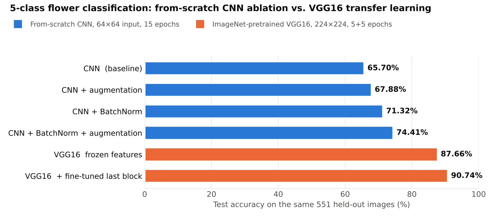
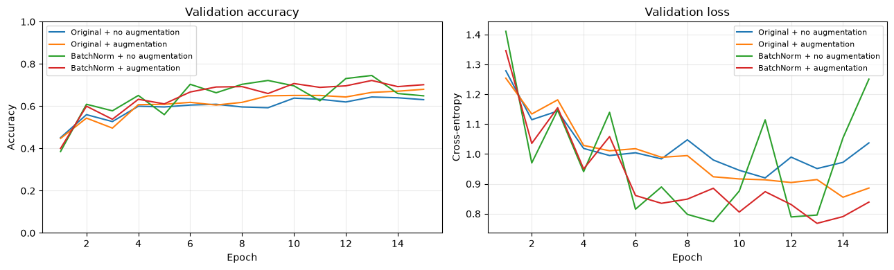
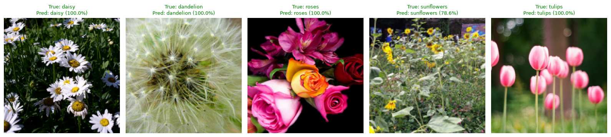
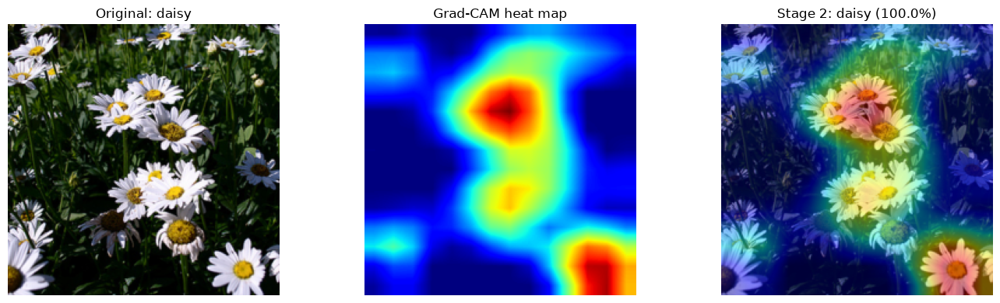

# Flower Image Classification: CNN Ablation → VGG16 Transfer Learning → Grad-CAM

> A controlled study of what actually moves accuracy on a small image dataset: a from-scratch PyTorch CNN ablated over **BatchNorm × data augmentation**, then an **ImageNet-pretrained VGG16** trained in two stages, with **Grad-CAM** to check what the final model looks at.


<picture>
  <source media="(prefers-color-scheme: dark)" srcset="images/results_summary_dark.png">
  
</picture>

## Headline results

All six models are scored on the **same stratified 551-image held-out test set** (5 classes, 3,670 photos split 70 / 15 / 15 with a fixed seed). Every number below is copied from the saved notebook outputs.

| Model | Input | Test accuracy | Macro precision |
|---|---|---:|---:|
| From-scratch CNN (baseline) | 64×64 | 65.70% | 65.41% |
| + data augmentation | 64×64 | 67.88% | 68.30% |
| + BatchNorm | 64×64 | 71.32% | 71.94% |
| + BatchNorm + augmentation | 64×64 | 74.41% | 75.92% |
| VGG16, frozen conv base (stage 1) | 224×224 | 87.66% | 88.20% |
| **VGG16, last conv block fine-tuned (stage 2)** | 224×224 | **90.74%** | **90.61%** |

**Takeaways**

- **BatchNorm was the bigger lever for the small CNN** (+5.62 pts) versus augmentation alone (+2.18 pts); together they added +8.71 pts.
- **BatchNorm without augmentation overfit hard.** Training accuracy climbed to 92.2% while validation accuracy fell back to 64.9% and validation loss spiked after epoch 13 (see curves below). Selecting the checkpoint by lowest validation loss (epoch 9) avoided reporting those overfit final weights.
- **Pretrained VGG16 far outperformed the small CNN on 2.6k training images.** Training only VGG16's classifier on frozen features beat the best from-scratch CNN by 13 pts in 1 minute of GPU time. The comparison also changes input size (224 vs. 64 px), augmentation, and batch size, so the gap is not purely the effect of pretraining; unfreezing the last conv block at a 10× lower learning rate added another 3.08 pts.
- **On the Grad-CAM example, the model's attention falls on the blossoms, not the background.**

## 1. From-scratch CNN ablation (BatchNorm × augmentation)

[`notebooks/01_cnn_batchnorm_augmentation_ablation.ipynb`](notebooks/01_cnn_batchnorm_augmentation_ablation.ipynb)

A 2×2 design where only one factor changes at a time. Split, seed, optimizer (Adam, lr 1e-3), batch size (64), epochs (15), and test set are held fixed across all four runs, and the model is re-seeded before each run.

```text
[N,3,64,64] ─Conv3×3(16)─(BN)─ReLU─MaxPool─► [N,16,32,32]
            ─Conv3×3(32)─(BN)─ReLU─MaxPool─► [N,32,16,16]
            ─Conv3×3(64)─(BN)─ReLU─MaxPool─► [N,64,8,8]
            ─Flatten(4096)─Linear(64)─ReLU─Linear(5)─► logits [N,5]
```

- **Augmentation (train only):** random horizontal flip, ±15° rotation, brightness/contrast jitter.
- **Model selection:** best epoch by validation loss; weights restored before testing.
- **Leakage guard:** `assert`s that train / validation / test file sets are pairwise disjoint.



## 2. VGG16 transfer learning in two stages

[`notebooks/02_vgg16_transfer_learning_gradcam.ipynb`](notebooks/02_vgg16_transfer_learning_gradcam.ipynb)

| Stage | What trains | Optimizer | Trainable params | Best epoch (val loss) | Test acc. |
|---|---|---|---:|---:|---:|
| 1 | Fully connected classifier only (conv base frozen); final layer replaced 1000 → 5 | Adam, lr 1e-3 | 119.6 M | 3 / 5 | 87.66% |
| 2 | + last conv block (`features[24:]`) | Adam, lr 1e-4 | 126.6 M | 5 / 5 | 90.74% |

- ImageNet normalization; `RandomResizedCrop(224, scale 0.75–1.0)`, flip, and ±10° rotation for training; `Resize(256) → CenterCrop(224)` for evaluation.
- Shape checks (`assert output.shape == (N, 5)`) before any training.

One held-out test image per class, classified by the stage-2 model:



## 3. Grad-CAM: what is the model looking at?

Grad-CAM is implemented directly with PyTorch forward/backward hooks (no extra library): the gradient of the predicted class score with respect to the last conv layer's activations (`features[28]`, 512 channels) is global-average-pooled into channel weights, combined with the activations, passed through ReLU, and upsampled to 224×224.



On this image, the strongest activations sit on the daisy blossoms rather than the dark foliage. That is a single-image sanity check, not proof that the model avoids background shortcuts in general; running Grad-CAM over many test images, including the misclassified ones, would be the stronger test.

## Repository structure

```text
flower-image-classification/
├── README.md
├── requirements.txt
├── notebooks/
│   ├── 01_cnn_batchnorm_augmentation_ablation.ipynb   # 2×2 ablation, outputs saved
│   └── 02_vgg16_transfer_learning_gradcam.ipynb       # two-stage VGG16 + Grad-CAM, outputs saved
└── images/                                            # figures exported from the notebook outputs
```

## How to run

```bash
git clone https://github.com/reidsendroff/flower-image-classification.git
cd flower-image-classification
python -m venv .venv && source .venv/bin/activate
pip install -r requirements.txt          # install a CUDA build of torch if you have an NVIDIA GPU
jupyter lab notebooks/
```

The notebooks download the [TensorFlow `flower_photos`](https://www.tensorflow.org/tutorials/load_data/images) dataset (~220 MB) into `./data` and the VGG16 weights through torchvision on first run. The saved outputs come from a run on an NVIDIA RTX 5080 with PyTorch 2.9.1 (3.7 minutes for all four ablation runs; 1.0 minute for VGG16 stage 1); a CPU works but is much slower.

## Limitations and next steps

- Each configuration was trained **once on one split**, so small gaps (e.g. 65.70% vs. 67.88%) are within run-to-run noise. Next: repeat each run over 5 seeds and report mean ± std.
- Macro precision is reported; a per-class confusion matrix and recall would show which classes drive the remaining errors.
- Compare against a lighter backbone (ResNet-18 / EfficientNet-B0) at a fraction of VGG16's 126 M trainable parameters.

## Skills demonstrated

**Deep learning:** CNN design, BatchNorm, data augmentation, transfer learning and staged fine-tuning (10× lower learning rate in stage 2), checkpoint selection by validation loss, Grad-CAM.
**Experimental practice:** controlled ablations, fixed seeds and splits, leakage assertions, a single shared test set across all models.
**Tooling:** PyTorch (`nn.Module`, custom `Dataset`, hooks), torchvision, scikit-learn, pandas, matplotlib, CUDA.

## Context

Built by **Reid Sendroff** ([LinkedIn](https://www.linkedin.com/in/reidsendroff)) for Harvard Extension School's graduate **CSCI E-89 Deep Learning** course (2026).
